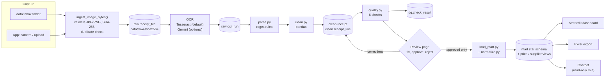

# Restaurant Receipt Pipeline

A local data pipeline for a family restaurant: staff photograph supplier receipts, and the
pipeline turns them into clean, reviewed data in PostgreSQL, with an Excel export, a Streamlit
dashboard, price alerts, a supplier comparison and a read-only text-to-SQL chatbot.

Built with free, open-source tools only, running on one Windows laptop.

## The problem

Today every receipt is typed into Excel by hand. That is slow, receipts get entered twice,
mistakes go unnoticed, the paper originals get lost, item names are inconsistent
(`CHKN BRST 10LB` vs. `CHICKEN BREAST BNLS 10 LB`), and nobody can easily see whether prices
are going up or which supplier is cheaper.

## What it does

- **Capture:** drop photos in `data/inbox/`, or use the app's camera / upload page (works on a phone).
  A long receipt can be taken as **several photos**; they are joined top to bottom and read as one
  receipt (like a document scanner app).
- **No duplicates:** every image is identified by its SHA-256 hash; the same photo is never stored twice.
- **Keeps originals:** images are stored unchanged under their hash, for audit.
- **Reads receipts:** Tesseract OCR (free, offline) by default; Gemini as an optional comparison.
- **Catches bad receipts:** 6 data-quality checks; anything suspicious goes to a review queue.
- **Human review:** fix fields next to the receipt image; every change is logged.
- **Analytics on trusted data only:** approved receipts feed a star schema (`mart`).
- **Standard items:** messy descriptions are mapped to standard items and units (lb, each, L).
- **Prices:** price history per item and supplier, with alerts for increases above a threshold.
- **Suppliers:** latest prices side by side, with **estimated** monthly savings.
- **Excel export** for the people who live in Excel, and a **chatbot** for quick questions.

## Architecture



Layers: **raw** (what we received, never edited) → **clean** (standardized, reviewable) →
**dq** (quality results) → **mart** (star schema, approved receipts only).
More detail: [docs/architecture.md](docs/architecture.md) and
[docs/database_schema.md](docs/database_schema.md).

| Part | Tool |
|---|---|
| Language | Python 3.12 |
| Database | PostgreSQL, accessed with psycopg 3 and plain SQL (no ORM) |
| Schema changes | numbered `.sql` files in `sql/` applied by `scripts/setup_db.py` |
| Cleaning | pandas; money as `Decimal` / `NUMERIC(12,2)` |
| OCR | Tesseract (`pytesseract`); Gemini optional (`google-genai`) |
| App | Streamlit (multipage), password-protected |
| SQL safety for the chatbot | `sqlglot` + read-only PostgreSQL role |
| Tests | pytest (351 tests) |
| Scheduling | Windows Task Scheduler |

## Setup (Windows, PowerShell)

### 1. Python environment

```powershell
cd "<project folder>"
py -3.12 -m venv .venv
.\.venv\Scripts\Activate.ps1
python -m pip install --upgrade pip
pip install -r requirements.txt
```

If activation is blocked, run this once:
`Set-ExecutionPolicy -Scope CurrentUser -ExecutionPolicy RemoteSigned`

### 2. Tesseract OCR

1. Install it with winget:
   `winget install --id UB-Mannheim.TesseractOCR -e`
   (or download the installer from https://github.com/UB-Mannheim/tesseract/wiki)
2. Add `C:\Program Files\Tesseract-OCR` to your user PATH:
   ```powershell
   [Environment]::SetEnvironmentVariable("Path", [Environment]::GetEnvironmentVariable("Path", "User") + ";C:\Program Files\Tesseract-OCR", "User")
   ```
   Then close and reopen the terminal (and VS Code).
3. Or skip the PATH step and set `TESSERACT_CMD` in `.env` to the full path of `tesseract.exe`.

### 3. Config

```powershell
Copy-Item .env.example .env
```
Then edit `.env`. Set `DB_APP_PASSWORD` and `DB_READONLY_PASSWORD` to long random strings.

### 4. Database (one time)

```powershell
python scripts\bootstrap_db.py      # asks for the postgres superuser password (not saved)
python scripts\setup_db.py          # creates the tables; safe to run again
```

`bootstrap_db.py` creates the `receipts` and `receipts_test` databases, runs
`sql/000_roles_and_schemas.sql` in both (two roles, four schemas), and sets the role passwords
from `.env`. You can also run `000_roles_and_schemas.sql` by hand in pgAdmin; see the comments at
the top of the file.

### 5. Check everything works

```powershell
python -c "import pandas, psycopg, pytesseract, PIL; print('imports ok')"
tesseract --version
python -m pytest -q                 # uses the receipts_test database, never the real one
```

## Try it with the fake sample receipts

`data/sample/` has 50 synthetic receipts from 4 made-up vendors (made by
`scripts/make_sample_receipts.py`), each with a ground-truth JSON file. They include deliberate
problems: 3 wrong totals, 1 subtotal that doesn't match its lines, 1 re-photographed duplicate and
1 byte-for-byte duplicate file.

```powershell
python -m src.run_pipeline --sample        # ingest -> OCR -> parse -> clean -> checks -> mart
python scripts\demo_review_samples.py      # DEMO ONLY: plays the reviewer for the sample receipts
python scripts\set_app_password.py         # choose the app password (stored only as a hash)
streamlit run app\Home.py                  # http://localhost:8501
```

`demo_review_samples.py` corrects the sample receipts to their ground truth through the normal
review code (every change logged), approves the clean ones, rejects the duplicate and leaves the
deliberately wrong ones for a human. It never touches real receipts (checked by file hash).

## Daily use

```powershell
python -m src.run_pipeline       # process new photos in data\inbox\ (or let Task Scheduler do it)
streamlit run app\Home.py        # review, export, dashboards
python -m src.export_excel       # Excel file of approved receipts in exports\
```

**Long receipts:** on **Add Receipt**, choose "Several photos = one long receipt". With the camera,
take the photos top to bottom and press **Add as photo N** after each; with upload, select the photos
in order. Avoid overlapping photos: a line that appears twice is counted twice (the quality checks
will flag the receipt if the lines no longer add up).

App pages: **Home** (overview) · **Add Receipt** (camera or upload) · **Review** · **Export** ·
**Items** (mapping rules) · **Spending** · **Prices** · **Suppliers** · **OCR Evaluation** · **Chatbot**.

## Run automatically every 30 minutes (Windows Task Scheduler)

The pipeline is safe to run on a schedule: a lock file (`pipeline.lock`) stops two runs from
overlapping, files that crash go to `data\failed\`, and everything is logged to `logs\pipeline.log`
(IDs, counts and error types only, never receipt contents).

**Option A: one PowerShell command.** Run it from the project folder:

```powershell
$project = (Get-Location).Path
$action  = New-ScheduledTaskAction -Execute "$project\.venv\Scripts\pythonw.exe" -Argument "-m src.run_pipeline" -WorkingDirectory $project
$trigger = New-ScheduledTaskTrigger -Once -At (Get-Date).AddMinutes(1) -RepetitionInterval (New-TimeSpan -Minutes 30)
$settings = New-ScheduledTaskSettingsSet -MultipleInstances IgnoreNew -StartWhenAvailable
Register-ScheduledTask -TaskName "Receipt Pipeline" -Action $action -Trigger $trigger -Settings $settings -Description "Process receipt photos in data\inbox"
```

**Option B: by hand.**

1. Open **Task Scheduler** (Start menu, type "Task Scheduler").
2. **Action → Create Task…**
3. **General** tab: Name `Receipt Pipeline`. Choose "Run only when user is logged on".
4. **Triggers** tab → **New…**: "On a schedule", **One time**, start now; tick **Repeat task every: 30 minutes**,
   for a duration of: **Indefinitely** → OK.
5. **Actions** tab → **New…**: "Start a program".
   - Program/script: `<project folder>\.venv\Scripts\pythonw.exe`
   - Add arguments: `-m src.run_pipeline`
   - Start in: `<project folder>`
6. **Settings** tab: "If the task is already running": **Do not start a new instance** → OK.

(`pythonw.exe` runs without opening a console window.)

**Check it works:** right-click the task → **Run**, then look at the end of the log:
```powershell
Get-Content logs\pipeline.log -Tail 5
```
Exit codes: `0` done, `1` error (details in the log), `2` skipped because another run was still going.

To remove it: `Unregister-ScheduledTask -TaskName "Receipt Pipeline"`

## OCR evaluation and the optional Gemini method

```powershell
python -m src.evaluate_ocr                   # Tesseract vs. ground truth -> docs\ocr_evaluation.md
```

To compare with Gemini (free tier): get an API key at https://aistudio.google.com/apikey, put it in
`.env` as `GEMINI_API_KEY=...`, then run:

```powershell
python -m src.evaluate_ocr --method gemini   # adds a Gemini column to docs\ocr_evaluation.md
```

To use Gemini in the pipeline, also set `OCR_METHOD=gemini`. Gemini only ever receives the fake
sample receipts (checked by file hash). Real receipts stay on Tesseract unless you set
`ALLOW_EXTERNAL_AI_ON_PRIVATE=true`.

## Chatbot (text-to-SQL, read-only)

Needs `GEMINI_API_KEY` in `.env`. Use the **Chatbot** page, or the terminal:

```powershell
python -m src.chatbot "How much did we spend with each vendor?"
python -m src.chatbot --evaluate     # score on the 25 questions in tests\chatbot_questions.json
```

Safety: Gemini only gets the mart table structure and the question, never receipt data. The SQL
it returns must parse (with `sqlglot`) as a single SELECT on `mart.` objects, gets `LIMIT 200`, and
runs as the `receipts_readonly` role in a read-only transaction with a 5-second timeout. The
one-line plain-English answer sends the small result table to Gemini, so it is only produced when
all stored images are sample receipts (or you allow it).

## Using on a phone

Browsers only allow the camera on **HTTPS** pages or on `localhost`. A phone opening
`http://<laptop-ip>:8501` can still use **Upload Receipt** (which can take a photo with the phone's
camera app), but not **Take Photo**.

Chosen setup: **Tailscale** (free personal plan). It gives a private HTTPS address that only your
own devices can open. Nothing is put on the public internet.

1. Install Tailscale on the laptop (https://tailscale.com/download) and sign in.
2. Install the Tailscale app on each phone and sign in with the same account.
3. In the Tailscale admin console, under **DNS**, turn on **MagicDNS** and **HTTPS certificates**.
4. Start the app on the laptop: `streamlit run app\Home.py`
5. In a second terminal on the laptop: `tailscale serve --bg 8501`
6. It prints an address like `https://<laptop-name>.<tailnet>.ts.net`. Open it on the phone.
7. To stop sharing: `tailscale serve reset`

Do **not** use public tunnels (ngrok, Cloudflare quick tunnels, etc.) with real receipts.

## Privacy and security

- Runs locally. Real receipts, OCR output and exports never go in Git (`.gitignore`); the public
  demo uses fake receipts only.
- Secrets live in `.env` (not committed). The app password is stored only as a salted PBKDF2 hash.
- Two database roles: `receipts_app` (pipeline and app, not a superuser) and `receipts_readonly`
  (SELECT on `mart` only, used only by the chatbot).
- Parameterized queries everywhere.
- Every image is checked: JPG/PNG only (real format, not just the extension), opens and verifies in
  Pillow, max 10 MB and 50 megapixels, saved under a server-generated name (`<sha256>.<ext>`).
- Receipt images are never served from a static folder (`enableStaticServing = false`).
- Logs contain IDs, counts and error types, never receipt contents.

## Results (measured on the 50 synthetic sample receipts)

All numbers below were measured by the code in this repo on the fake sample data. Real photos are
messier, so real-world accuracy will be lower.

| Metric | Result | How it was measured |
|---|---|---|
| Images processed | 50 → 49 receipts, 0 failures | `run_pipeline --sample` |
| Duplicates caught | 2 of 2 planted: 1 exact file (hash, at ingestion), 1 re-photographed receipt (quality check) | pipeline + `dq.check_result` |
| OCR (Tesseract): vendor / date / receipt no. / total | 100% / 100% / 100% / 96.0% | `src/evaluate_ocr.py` |
| OCR (Tesseract): line items fully correct | 69.2% (quantity 78.8%, unit price 90.4%, line total 90.0% of matched lines) | `src/evaluate_ocr.py` |
| OCR (Tesseract): average time | 527 ms per receipt | `src/evaluate_ocr.py` |
| OCR (Gemini) | not measured yet (needs an API key) | `evaluate_ocr --method gemini` |
| Data-quality failures right after OCR (49 receipts) | required fields 40, lines ≠ subtotal 20, total ≠ subtotal + tax 6, duplicate 1, invalid date 0, negative 0 → 41 sent to review | `src/quality.py` |
| Review (demo reviewer on sample data) | 112 field corrections logged; 44 approved, 1 rejected, 4 left for a human | `scripts/demo_review_samples.py` |
| Items tracked | 24 standard items, 0 unmapped descriptions | `mart.dim_item` |
| Price alerts | 1 (the planted +14.8% chicken breast increase) | `mart.v_price_alerts` |
| Suppliers compared | 5 items across 4 suppliers | `mart.v_supplier_savings` |
| Estimated monthly savings | $57.33 (**estimate**: ignores delivery fees, minimums, quality, availability) | `mart.v_supplier_savings` |
| Chatbot accuracy | not measured yet (needs an API key); safety: 21 of 21 unsafe test queries blocked | `src/chatbot.py`, `tests/test_chatbot.py` |
| Automated tests | 351 passing | `python -m pytest` |

Full OCR report: [docs/ocr_evaluation.md](docs/ocr_evaluation.md).

### Manual-entry time saved

To be measured (with the family, on real receipts).

## Screenshots

Not added yet. To add them: load the sample data (see above), open each page, and save
screenshots in `docs/screenshots/`.

## Project layout

```
sql/        numbered schema files (000 run by the superuser, 001+ by setup_db.py) and queries/
src/        pipeline code (ingest, ocr, parse, clean, quality, review, load_mart, normalize,
            prices, export_excel, evaluate_ocr, chatbot, run_pipeline, ...)
app/        Streamlit app (Home.py + pages/)
scripts/    setup, sample generator, demo reviewer, app password
tests/      pytest tests (+ chatbot_questions.json)
docs/       architecture, database schema, OCR evaluation
data/       inbox/ raw/ failed/ private/ (all gitignored) and sample/ (fake receipts)
```
