# Architecture

## Overview

Everything runs on one Windows laptop: a Python pipeline, a local PostgreSQL database and a
Streamlit app. There is no cloud service. Gemini (optional) is the only external call, and by
default it only ever sees the fake sample receipts.

```mermaid
flowchart TB
    subgraph Sources
        INBOX[data/inbox folder]
        CAM[Add Receipt page<br/>camera / upload]
    end

    subgraph Pipeline["Pipeline (src/, run by run_pipeline.py or the app)"]
        ING[ingest.py<br/>ingest_image_bytes]
        OCR[ocr.py<br/>Tesseract / Gemini]
        PARSE[parse.py]
        CLEAN[clean.py]
        DQ[quality.py]
        MART[load_mart.py + normalize.py]
    end

    subgraph DB["PostgreSQL: receipts"]
        RAW[(raw)]
        CL[(clean)]
        DQS[(dq)]
        M[(mart)]
    end

    subgraph App["Streamlit app (password-protected)"]
        REV[Review]
        DASH[Dashboard pages]
        EXP[Export]
        BOT[Chatbot]
    end

    INBOX --> ING
    CAM --> ING
    ING --> RAW
    RAW --> OCR --> RAW
    RAW --> PARSE --> CLEAN --> CL
    CL --> DQ --> DQS
    DQS --> REV
    CL --> REV
    REV -->|corrections, approve/reject| CL
    CL -->|approved only| MART --> M
    M --> DASH
    M --> EXP
    M -->|receipts_readonly role| BOT
```

## Data flow, step by step

| Step | File | Reads | Writes | Rerun-safe because |
|---|---|---|---|---|
| 1. Ingest | `src/ingest.py` | inbox files / uploaded bytes | `data/raw/<sha256>.<ext>`, `raw.receipt_file` | SHA-256 is `UNIQUE`; duplicates return the existing `file_id` |
| 2. OCR | `src/ocr.py` | files with status `new` | `raw.ocr_run`, status `ocr_done` / `failed` | only `new` files are picked |
| 3. Parse | `src/parse.py` | OCR text | (in memory) | pure function |
| 4. Clean + load | `src/clean.py` | files with status `ocr_done` | `clean.receipt`, `clean.receipt_line`, status `parsed` | `clean.receipt.file_id` is `UNIQUE`; existing receipts are skipped |
| 5. Quality | `src/quality.py` | one receipt | `dq.check_result`, `review_status` | results for a receipt are replaced, not added |
| 6. Review | `src/review.py`, `app/pages/2_Review.py` | receipt + checks + image | corrected values, `clean.correction`, status | every change is logged |
| 7. Mart | `src/load_mart.py`, `src/normalize.py` | approved receipts, `mart.item_mapping` | dims and `mart.fact_purchase_line` | facts are deleted and re-inserted in one transaction |
| 8. Use | `src/export_excel.py`, `src/prices.py`, `src/dashboard.py`, `src/chatbot.py` | mart | Excel file, pages | read-only |

`src/run_pipeline.py` runs steps 1–5 and 7 in order (with a lock file and a log file for scheduled
runs). The Add Receipt page runs steps 1–5 for one image right away (`process_single_image`).

## Layers

- **raw**: exactly what we received (image hash, path, source, OCR output). Never edited, so
  anything can be reprocessed later with a better parser or OCR method.
- **clean**: standardized values with the raw text kept beside them (`vendor_raw`,
  `receipt_date_raw`, `description_raw`, `unit_raw`). This is the layer people review and correct.
- **dq**: the result of every quality check for every receipt.
- **mart**: a star schema for analytics, built only from **approved** receipts.

Lineage from any number on a dashboard back to the photo:
`mart.fact_purchase_line.line_id` → `clean.receipt_line` → `clean.receipt.ocr_run_id` →
`raw.ocr_run.file_id` → `raw.receipt_file.stored_path` → the original image.

## Key design decisions

(See also section 10 of `CLAUDE.md`.)

- **Plain SQL over an ORM.** The SQL is visible, testable and easy to explain.
- **Raw → clean → mart layers.** Raw is never edited; clean is reviewable; mart is analytics only.
- **Hash-based file names.** Prevent duplicates and path tricks, and give every file a stable ID.
- **One intake function.** Folder, upload and camera all go through `ingest_image_bytes`, so
  validation and duplicate detection can't be skipped.
- **Never guess.** The parser returns `None` for anything it can't read; quality checks then send
  the receipt to review instead of loading a guessed number.
- **Only approved receipts reach the mart.** Analytics are trusted; mistakes are caught in review.
- **Idempotent steps.** Every step can be rerun safely, which makes scheduling and recovery simple.
- **Autocommit + explicit transactions.** Connections save each statement immediately; anything
  that must succeed together (a receipt and its lines, an OCR row and its status, the whole mart
  rebuild) is wrapped in `with conn.transaction():`.
- **Tesseract default, Gemini optional.** Free and private by default; Gemini is compared on fake data.
- **Read-only role for the chatbot.** AI-written SQL is untrusted: it is parsed and checked with
  `sqlglot`, then run by a role that physically cannot change data, with a timeout and a row limit.
- **Local only.** Two app passwords (staff and developer) choose a simple or a full menu; they are
  not user accounts. Real user accounts would be needed before going online.

## Security summary

| Risk | Control |
|---|---|
| Malicious or broken image files | JPG/PNG only (real format), `Image.verify()`, 10 MB and 50 MP limits |
| Path tricks in file names | files saved as `<sha256>.<ext>`; original name kept only as a label |
| SQL injection | parameterized queries (`%s`) everywhere; identifiers via `psycopg.sql` |
| AI-written SQL | `sqlglot` validation, `receipts_readonly` role, read-only transaction, 5 s timeout, `LIMIT 200` |
| Real receipts sent to an external API | Gemini allowed only for sample images (by hash) unless explicitly enabled |
| Secrets in Git | `.env` ignored; only `.env.example` committed; app password stored as a hash |
| Receipts exposed on the network | static serving off; phone access through Tailscale (private), no public tunnels |
| Sensitive data in logs | logs hold IDs, counts and error types only |
