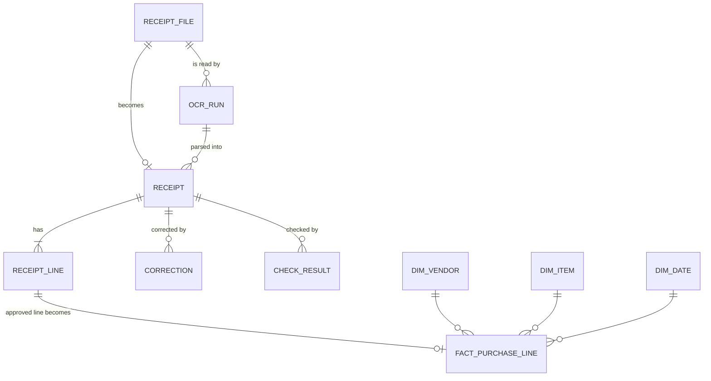

# Database schema

PostgreSQL database `receipts` (tests use `receipts_test`). Schema files live in `sql/` and are
applied in order by `scripts/setup_db.py`, which records each file in `public.schema_version`.

| File | Creates |
|---|---|
| `000_roles_and_schemas.sql` | roles `receipts_app`, `receipts_readonly`; schemas `raw`, `clean`, `dq`, `mart`; grants (run once as superuser) |
| `001_raw.sql` | `raw.receipt_file`, `raw.ocr_run` |
| `002_clean.sql` | `clean.vendor_mapping`, `clean.receipt`, `clean.receipt_line`, `clean.correction` |
| `003_dq.sql` | `dq.check_result` |
| `004_mart.sql` | `mart.dim_vendor`, `mart.dim_item`, `mart.dim_date`, `mart.fact_purchase_line` |
| `005_item_mapping.sql` | `mart.item_mapping` (+ rules for the sample items) |
| `006_price_views.sql` | `mart.setting`, views `mart.v_price_history`, `mart.v_price_alerts` |
| `007_supplier_comparison.sql` | views `mart.v_supplier_comparison`, `mart.v_supplier_savings` |

## Roles

| Role | Can do | Used by |
|---|---|---|
| `receipts_app` | owns the four schemas (create, read, write) | pipeline, Streamlit app |
| `receipts_readonly` | `USAGE` on `mart`, `SELECT` on its tables and views (also future ones) | chatbot only |

## Entity relationships

## raw: what we received (never edited)

**raw.receipt_file**: one row per unique image.

| Column | Type | Notes |
|---|---|---|
| file_id | bigint identity | PK |
| sha256 | char(64) | UNIQUE; hash of the file bytes |
| stored_path | text | e.g. `data/raw/<sha256>.jpg` |
| original_name | text | label only, never used as a path |
| source | text | `inbox`, `upload`, `camera` |
| received_at | timestamptz | |
| status | text | `new`, `ocr_done`, `parsed`, `failed` |

**raw.ocr_run**: one row per OCR attempt.

| Column | Type | Notes |
|---|---|---|
| ocr_run_id | bigint identity | PK |
| file_id | bigint | FK → raw.receipt_file |
| method | text | `tesseract`, `gemini` |
| raw_text | text | Tesseract output |
| raw_json | jsonb | Gemini output (same structure as `parse.py`) |
| started_at | timestamptz | |
| duration_ms | integer | |
| error | text | error type if OCR failed |

## clean: standardized and reviewable

**clean.vendor_mapping**: `vendor_raw` (PK, uppercase) → `vendor_name`.

**clean.receipt**

| Column | Type | Notes |
|---|---|---|
| receipt_id | bigint identity | PK |
| file_id | bigint | FK → raw.receipt_file, UNIQUE |
| ocr_run_id | bigint | FK → raw.ocr_run |
| vendor_raw / vendor_name | text | as read / standardized |
| receipt_date_raw / receipt_date | text / date | as read / standardized |
| receipt_number | text | |
| subtotal, tax, total | numeric(12,2) | |
| review_status | text | `pending`, `needs_review`, `approved`, `rejected` |
| created_at, updated_at | timestamptz | |

**clean.receipt_line**

| Column | Type | Notes |
|---|---|---|
| line_id | bigint identity | PK |
| receipt_id | bigint | FK → clean.receipt (cascade delete) |
| line_no | integer | UNIQUE with receipt_id |
| description_raw / description | text | as read / uppercase, single spaces |
| quantity | numeric(12,3) | |
| unit_raw | text | e.g. CS, LB, BAG |
| unit_price, line_total | numeric(12,2) | |

**clean.correction**: `correction_id`, `receipt_id`, `field_name` (e.g. `total`,
`line 3 quantity`, `line 4 added`, `review_status`), `old_value`, `new_value`, `corrected_at`.

## dq: data quality

**dq.check_result**: `check_id`, `receipt_id`, `check_name`, `passed`, `details`, `checked_at`;
UNIQUE (`receipt_id`, `check_name`). Checks: `required_fields`, `valid_date`,
`no_negative_values`, `lines_match_subtotal`, `total_is_subtotal_plus_tax`, `not_duplicate`,
`from_allowed_country` (Canada only by default; a receipt clearly from another country is set to
`rejected` automatically and the reason is logged in `clean.correction`).

## mart: star schema (approved receipts only)

**Grain of the fact table: one line item on one approved receipt.**

| Table | Columns |
|---|---|
| mart.dim_vendor | vendor_key PK, vendor_name UNIQUE |
| mart.dim_item | item_key PK, item_name UNIQUE (`UNMAPPED` = no rule yet), category, standard_unit (`lb`, `kg`, `each`, `L`) |
| mart.dim_date | date_key PK (YYYYMMDD; 0 = unknown), full_date, year, month, month_name, week, day_of_week |
| mart.fact_purchase_line | purchase_key PK, line_id UNIQUE (lineage), receipt_id, vendor_key, item_key, date_key, quantity, standard_quantity, line_total, unit_price_standard |
| mart.item_mapping | mapping_id PK, description_pattern UNIQUE (ILIKE-style), item_name, category, standard_unit, pack_size, pack_unit |
| mart.setting | name PK, value (e.g. `price_alert_threshold_pct`, copied from `.env` on every build) |

Views:

| View | One row per | Main columns |
|---|---|---|
| mart.v_price_history | item, vendor, purchase date | unit_price, quantity, previous_date, previous_price, pct_change |
| mart.v_price_alerts | price-history row above the threshold | same as above |
| mart.v_supplier_comparison | item × supplier (items from 2+ suppliers) | latest_price, cheapest_vendor, cheapest_price, price_difference, avg_monthly_quantity, estimated_monthly_savings |
| mart.v_supplier_savings | item | suppliers, cheapest_vendor, cheapest_price, estimated_monthly_savings |

**Rebuild rule:** `src/load_mart.py` upserts the dimensions, deletes and re-inserts all facts,
applies item normalization and copies settings, all inside one transaction. Rerunning gives the
same result; corrections made after approval are picked up by the next rebuild.

Example analytics queries: `sql/queries/01_spend_per_month.sql` … `05_average_receipt_by_vendor.sql`.
